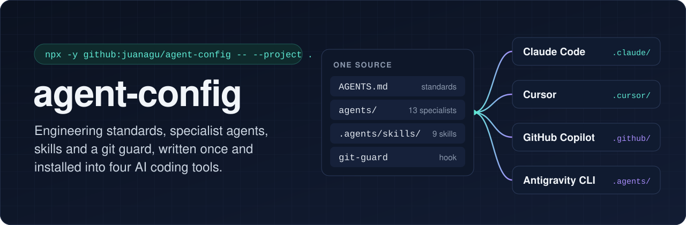
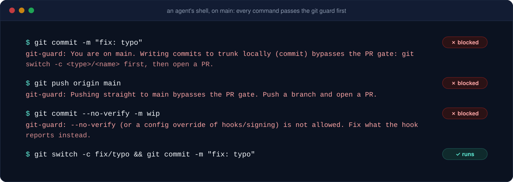
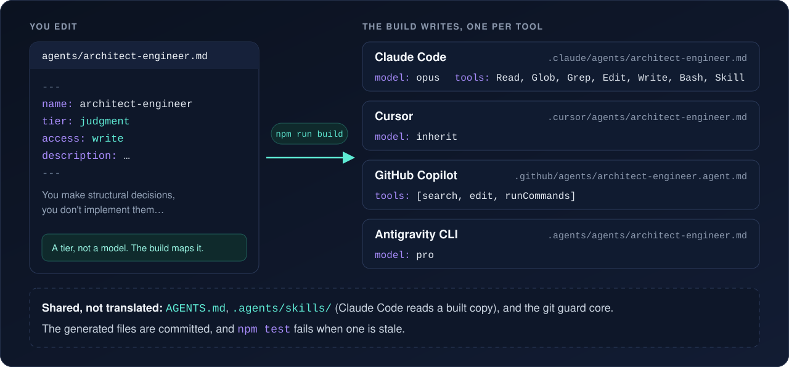

<h1 align="center">
  
</h1>

<p align="center">
  <a href="LICENSE"></a>
  
  
  
</p>

<p align="center">
  <a href="#install">Install</a> ·
  <a href="#what-you-get">What you get</a> ·
  <a href="#how-it-works">How it works</a> ·
  <a href="docs/customizing.md">Make it yours</a> ·
  <a href="docs/compatibility.md">Compatibility</a>
</p>

Engineering standards, a roster of specialist agents, skills and a git guard for AI coding tools, written once and installed into **Claude Code**, **Cursor**, **GitHub Copilot** and **Antigravity CLI**.

A rule in a standards file is followed most of the time, and "most of the time" is how a commit lands on `main`. So the parts a tool can enforce are enforced: a hook refuses what the standards can only ask for, a build keeps four tools' files in step, and a test fails when they drift.

It is opinionated: a specific stack (Next.js, Astro, Fastify, MongoDB, BullMQ, Flutter, Kotlin/Compose, Swift/SwiftUI, React Native on Expo, Cloudflare), trunk-based development with a PR gate, Airbnb as the UX reference. The mechanics are meant to be reused as they are; the content is meant to be forked and changed. [Making it yours](docs/customizing.md) says how.

## Install

Pick your tool. Each command writes the files that tool reads, nothing else, and never overwrites a file that differs.

**Into one project**, committed so the whole team's tools read it:

```sh
npx -y github:juanagu/agent-config -- --project . --tool claude      # Claude Code
npx -y github:juanagu/agent-config -- --project . --tool cursor      # Cursor
npx -y github:juanagu/agent-config -- --project . --tool copilot     # GitHub Copilot
npx -y github:juanagu/agent-config -- --project . --tool antigravity # Antigravity CLI
npx -y github:juanagu/agent-config -- --project .                    # all four
```

**For every project on a machine**, linking the tool's user folders into a clone that `npx` keeps up to date:

```sh
npx -y github:juanagu/agent-config -- --global --tool claude
```

Or copy by hand: the repository root *is* the install. `AGENTS.md`, `.agents/`, and the folder for your tool (`.claude/`, `.cursor/`, `.github/`) at the same paths in your project is all the installer does.

Requires Node.js 22+ and `git`. Then read the guide for your tool: [Claude Code](docs/claude-code.md), [Cursor](docs/cursor.md), [GitHub Copilot](docs/copilot.md), [Antigravity CLI](docs/antigravity.md). Each one says what loads where, how to invoke things, how to check it worked, and what bites.

## What you get

**Standards** ([`AGENTS.md`](AGENTS.md)). The rules every session starts with: the default stack and how to choose within it; design defaults (mobile-first for apps, desktop-led for marketing pages, placement before polish, tokens and shared primitives); code principles and the structure rules a lint can check; feature folders with a `feature_readme.md`; testing, including that a fake for a boundary is validated against the real one; the agent roster and the feature pipeline; the trunk-based workflow and the merge gate; task tracking; knowledge (the repo is the memory, not the chat); feature flags. Each rule says why.

**Agents** ([`agents/`](agents/)). Thirteen specialists, each a Markdown file your tool loads as a subagent or custom agent:

| Agent | Tier | For |
| --- | --- | --- |
| `product-strategist` | judgment | a raw idea into scope, users, priorities and a phased roadmap; no tech opinions |
| `architect-engineer` | judgment | boundaries and topology, short ADRs, when a change spans layers or introduces a pattern |
| `designer` | judgment | where a feature lives, new components and UX patterns, tokens; Airbnb as the reference |
| `security-engineer` | judgment | security review and threat modelling across the stack |
| `code-reviewer` | judgment | a review pass over a diff at low, medium or high; verdicts, never fixes |
| `backend-engineer` | implementation | Fastify APIs and BFFs, MongoDB repositories, BullMQ workers |
| `frontend-engineer` | implementation | Next.js, Astro and Flutter UI |
| `android-engineer`, `ios-engineer`, `react-native-engineer` | implementation | the native and Expo clients |
| `qa-engineer` | implementation | test strategy and verifying a change works, at two viewports and in every locale |
| `technical-writer` | implementation | READMEs, API docs, ADRs, changelogs |
| `devops-engineer` | implementation | Docker, CI/CD, Cloudflare; implements topology, does not decide it |

They work as a pipeline, each stage only when it applies, and two calls stay yours: the artboard for a new screen before it is built, and the merge, until you grant it:


Every agent ends with the same four-section report (changed, verified, deviations, needs the user) so the session re-checks claims instead of trusting them. The tier says what a wrong call costs and maps to each tool's model dialect ([ADR 0004](docs/adr/0004-tiers-not-models.md)). Each agent carries behavioural evals and routing cases for its description in `agents/evals/` ([how to run them](docs/agent-evals.md)), so a prompt change is measured against the old one instead of judged by how it reads.

**Skills** ([`.agents/skills/`](.agents/skills/)), in the [Agent Skills](https://agentskills.io) format all four tools read. Six architecture skills, one per stack (`nextjs-`, `fastify-`, `flutter-`, `android-`, `ios-`, `react-native-architecture`): the layout, the dependency rule as a table, where a new file goes, the anti-patterns seen in reviews, and the checklist a review brief copies. Four workflow skills: `open-pr` (a PR opens reviewed), `merge-gate` (the review loop and when a PR may merge), `resolve-pr-comments`, `retro` (when something slipped, find which part of the setup let it and file the fix). Each carries `evals/` ([how to run them](docs/skill-evals.md)). The global installer also offers third-party skills from `skills.txt`: `frontend-design`, `web-design-guidelines`, `security-threat-model`, `security-audit`, `conventional-commit`, `clean-code`.

**The git guard** ([`.agents/hooks/git-guard/`](.agents/hooks/git-guard/)). A hook that runs before every shell command and refuses what a standards file can only ask for: a commit on `main`, a push to it, `--no-verify`, a branch switch in a checkout that serves a dev server, an anonymous stash. One core, one adapter per tool. [docs/git-guard.md](docs/git-guard.md).



**Templates** ([`templates/`](templates/)). A two-tier GitHub Actions workflow (fast on every PR, full on a release tag) and a pre-push hook that mirrors the fast tier, for a new repo.

## How it works



One source, four dialects. `AGENTS.md` and the skills are read by every tool as they are. The agents are written once with neutral frontmatter and a build writes each tool's format; the hook registrations are generated from the same table; the generated files are committed and a test fails when they are stale. The repository root is laid out as a project that uses it, so the repo's own sessions read exactly what you install.

```
AGENTS.md            standards, read by every tool
CLAUDE.md            @AGENTS.md + Claude Code notes
.agents/             skills, hook code, Antigravity agents and hooks.json
.claude/             Claude Code agents, skill copies, settings.json
.cursor/             Cursor agents, hooks.json
.github/             Copilot agents and hooks
agents/              the agents' source
scripts/build.mjs    writes every generated file
```

[docs/architecture.md](docs/architecture.md) has the full layout, the frontmatter mapping and the hook adapters. [docs/compatibility.md](docs/compatibility.md) is the matrix of what each tool reads, with the documentation each row was verified against and the date; it is the first place to look when something stops loading.

## Making changes

- Standards: edit `AGENTS.md`. Agents: edit `agents/<name>.md`, then `npm run build`. Skills: edit `.agents/skills/<name>/SKILL.md`, then `npm run build` (Claude Code reads a copy).
- `npm test` checks all of it: frontmatter, cross-references, evals, the generated files, the installer, the hook in every tool's payload shape. The committed pre-push hook runs it before every push (`npm install` once installs the hook; there are no dependencies).
- Ship it through a PR; the `open-pr` skill does it the way the standards describe.

[CONTRIBUTING.md](CONTRIBUTING.md) has the details, including how to add support for another tool.

## Where it came from

This repo replaces [`juanagu/claude-code-config`](https://github.com/juanagu/claude-code-config), which did the same for Claude Code alone. [Migrating](docs/migrating-from-claude-code-config.md) maps the old layout to this one. The decisions are in [docs/adr/](docs/adr/).

## License

[MIT](LICENSE) for everything written here. Third-party skills listed in `skills.txt` are installed from their own repositories under their own licenses.
